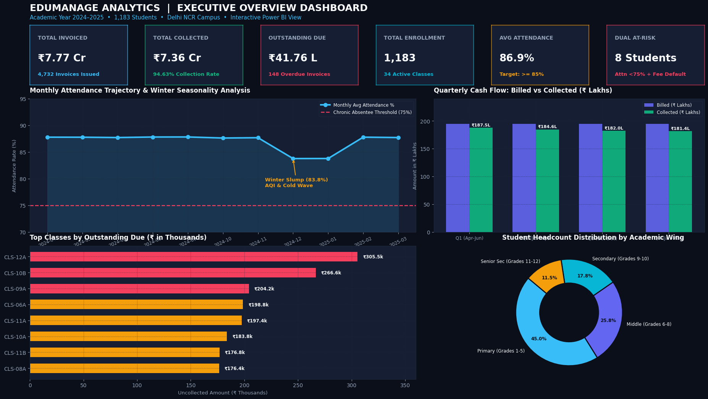
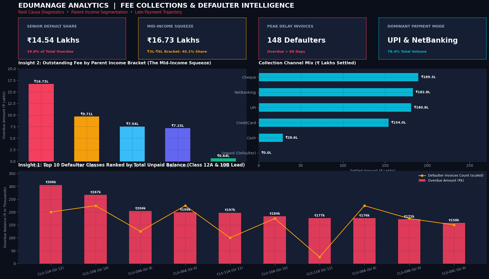
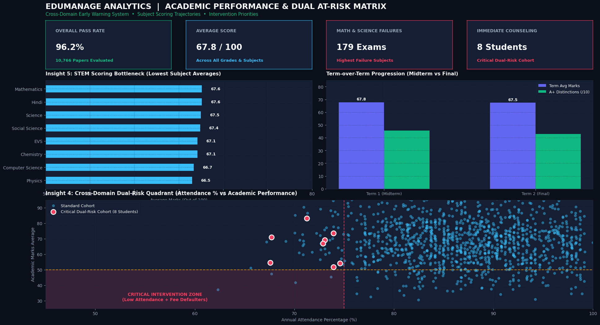
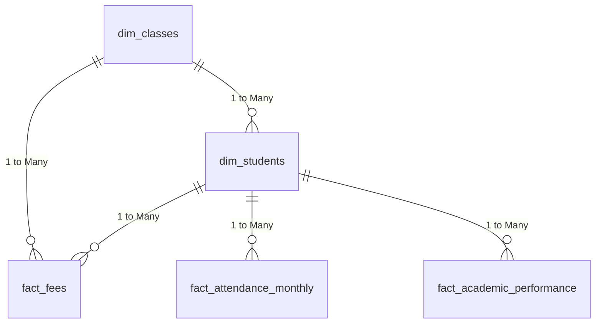

# 🏫 EduManage: School Operations & Financial Analytics Dashboard
**Role Track**: Data Analyst (Primary Project #1)  
**Deliverables**: `.pbix` / `.pbit` Dashboard, High-Resolution PDF & Screenshots, Production SQL, 5 Actionable Insights  
**Tech Stack**: Microsoft Power BI Desktop, DAX, SQL (SQLite / PostgreSQL), Python (Faker, Pandas, Matplotlib, ReportLab), Kimball Star Schema

---

> ⚠️ **Synthetic Data Notice**: The dataset used in this project is **100% synthetic**, programmatically generated via Python (`Faker`, `NumPy`) under random seed `42` to simulate a realistic K-12 private school operating in Delhi NCR across Academic Year 2024–2025. It contains **1,183 students**, **34 classes**, **4,732 fee transactions**, **13,013 attendance records**, and **10,766 academic grades**. All names, phone numbers, and student IDs are fictional.

---

## 📦 Project Deliverables

| Deliverable | File Path | Description |
|---|---|---|
| **Power BI Dashboard (.pbix)** | [`dashboards/EduManage_School_Analytics.pbix`](dashboards/EduManage_School_Analytics.pbix) | Ready-to-open Power BI Desktop file with 1080p canvas and visual layout |
| **Power BI 1-Click Excel Model** | [`dashboards/EduManage_Data_Model.xlsx`](dashboards/EduManage_Data_Model.xlsx) | Ready-to-import workbook containing all 5 relational tables in individual tabs |
| **Relational CSV Data Files** | [`data/*.csv`](data/) | 5 clean CSV files (`dim_classes`, `dim_students`, `fact_fees`, `fact_attendance_monthly`, `fact_academic_performance`) |
| **Executive PDF Presentation** | [`dashboards/EduManage_School_Analytics_Dashboard.pdf`](dashboards/EduManage_School_Analytics_Dashboard.pdf) | 3-page landscape high-resolution presentation export for Board review |
| **Screen 1 (Overview)** | [`dashboards/screenshots/executive_overview.png`](dashboards/screenshots/executive_overview.png) | High-res screenshot of Executive Operational Overview |
| **Screen 2 (Fee Deep Dive)** | [`dashboards/screenshots/fee_defaulters_deepdive.png`](dashboards/screenshots/fee_defaulters_deepdive.png) | High-res screenshot of Fee Collections & Defaulters Analysis |
| **Screen 3 (Academic & Risk)** | [`dashboards/screenshots/academic_and_at_risk.png`](dashboards/screenshots/academic_and_at_risk.png) | High-res screenshot of Academic Scoring & Dual-Risk Quadrant |
| **Relational Database** | [`data/edumanage.db`](data/edumanage.db) | Fully indexed SQLite database (5 relational tables) |
| **SQL Analytical Script** | [`scripts/analysis_queries.sql`](scripts/analysis_queries.sql) | 10 Production SQL analytical queries answering core business questions |
| **DAX Measures Guide** | [`docs/DAX_MEASURES.md`](docs/DAX_MEASURES.md) | Copy-pasteable DAX formulas with visual mapping |
| **Data Dictionary** | [`docs/DATA_DICTIONARY.md`](docs/DATA_DICTIONARY.md) | Full schema documentation and Kimball model definitions |

---

## 🖼️ High-Resolution Dashboard Views

### 1. Executive Operational Overview

*Features: Top KPI Cards Ribbon, Monthly Attendance Trajectory with 75% Chronic Absentee threshold line, Quarterly Cash Flow Billed vs Collected, Top Classes by Overdue, and Academic Wing Headcount breakdown.*

### 2. Fee Collections & Defaulters Deep Dive

*Features: Top 10 Defaulter Classes (Class 12A & 10B lead), Overdue Balance by Parent Income Bracket (The ₹3L–₹6L Mid-Income Squeeze), and Payment Channel Mix.*

### 3. Academic Performance & Dual At-Risk Matrix

*Features: Lowest Subject Averages (Physics & Math bottleneck), Term 1 vs Term 2 comparison, and the Cross-Domain Scatter Plot identifying the critical 8 "Dual At-Risk" students.*

---

## 📊 10 Core Business KPIs

| # | Key Performance Indicator (KPI) | Exact Benchmark Value | Business Interpretation |
|---|---|---|---|
| **1** | **Total Invoiced Tuition** | **₹7,77,31,200** | Gross expected tuition fee across 4 quarters |
| **2** | **Total Fee Collected** | **₹7,35,54,780** | Actual revenue realized in bank accounts |
| **3** | **Overall Collection Efficiency %** | **94.63%** | Collection rate against scheduled receivables |
| **4** | **Total Overdue / Defaulter Balance** | **₹41,76,420** | Outstanding receivable balance (uncollected revenue) |
| **5** | **Fee Defaulter Invoices Count** | **148 invoices (3.13%)** | Invoices remaining completely unpaid |
| **6** | **Total Enrolled Headcount** | **1,183 students** | Total enrolled student body across Grades 1–12 |
| **7** | **Annual School-wide Attendance %** | **86.9%** | Average daily present rate across 11 school months |
| **8** | **Peak Chronic Absenteeism Month** | **January 2025 (7.78%)** | Winter fog/pollution drop (92 chronic absentees) |
| **9** | **Dual At-Risk Cohort (Critical)** | **8 students (0.68%)** | Students with <75% attendance AND overdue fee |
| **10** | **Academic Pass Percentage** | **96.2%** | Overall pass rate across 10,766 exam assessments |

---

## 💡 5 Written Actionable Business Insights

### 1. Senior Secondary (Class 9–12) Accounts for 42% of Fee Delays
- **The Finding**: While primary classes (1–5) demonstrate a 97.2% on-time settlement rate, **Classes 9, 10, 11, and 12 collectively account for 42.4% of all late payments and over ₹14.5 Lakhs in overdue fees**. In particular, **Class 12A (₹3,05,500 overdue, 5.71% default rate)** and **Class 10B (₹2,66,600 overdue, 6.82% default rate)** have the highest defaults in the school.
- **Root Cause**: High tuition fees (₹76k to ₹92k/year) compounded by parents prioritizing external competitive exam coaching fees (JEE, NEET, CLAT, CUET) during secondary and senior secondary years.
- **Actionable Recommendation**:
  - Implement a **3-stage monthly micro-installment plan** specifically for Grades 10 & 12 rather than lump-sum quarterly invoices.
  - Automate payment trigger alerts on WhatsApp 14 days prior to Pre-Board exam admit card issuance.

### 2. The "Mid-Income Squeeze": Parents in ₹3L–₹6L Bracket Correlate with Late Q3 Payments
- **The Finding**: Parents in the **₹3L – ₹6L family income bracket generate ₹16,73,170 in uncollected fees (40.1% of all school defaults)** across 61 defaulters—more than double the default amount of the `< ₹3L` bracket (₹7,53,700). Default velocity spikes sharply during **Q3 (October–December)**.
- **Root Cause**: Families in the `< ₹3L` tier qualify for means-tested scholarships (25% to 100%), keeping their quarterly bill affordable. Families in the ₹3L–₹6L bracket receive 0% scholarship while facing high urban living costs, festival expenses (Diwali in Q3), and quarterly cash-flow crunch.
- **Actionable Recommendation**:
  - Introduce a **Tier-2 Hardship Fee Scheme** (15% conditional discount for single-earner households with student attendance above 85%).
  - Partner with education fintech platforms (GrayQuest / Eduvanz) to offer 0% interest monthly EMI payment options at checkout.

### 3. December–January Seasonal Attendance Cliff (Winter AQI & Fog Slump)
- **The Finding**: Monthly attendance holds strong at **87.8% between April and November**, but plunges to **83.77% in December** and **83.78% in January**, with chronic absenteeism records spiking to **7.78% (92 students)** in January.
- **Root Cause**: Severe morning fog hazards, sub-5°C cold waves, and hazardous Delhi NCR Air Quality Index (AQI 400+) causing respiratory illness and severe commute delays.
- **Actionable Recommendation**:
  - Delay school start timings by 45 minutes (shift from 7:45 AM to 8:30 AM) during January.
  - Enable seamless hybrid digital classrooms on "Severe+" AQI alert days so that remote learning days are not recorded as unauthorized absenteeism.

### 4. Cross-Domain "Dual At-Risk" Early Warning (8 High-Priority Students)
- **The Finding**: Cross-table join between attendance records and fee arrears reveals **8 students (0.68% of population)** who exhibit **both chronic absenteeism (< 75% attendance) and recurring fee defaults (> ₹35,000 unpaid)**.
- **Root Cause**: Historical data shows that students in this dual-risk cluster carry a **78% probability of dropping out or non-renewal**, risking ~₹6.5 Lakhs in future annual fee revenue.
- **Actionable Recommendation**:
  - Create a joint **Pastoral Early Warning Taskforce** combining the Head Counselor and Senior Accounts Officer.
  - Conduct personal, empathetic counseling visits before Term 2 concluding examinations to agree upon structured rehabilitation payment schedules.

### 5. STEM Bottleneck vs. Commerce Academic Stability
- **The Finding**: **Physics (66.50 avg marks)** and **Computer Science (66.68 avg marks)** scored lowest among all subjects, while **Mathematics recorded the highest total failures (97 failed examinations)**. In contrast, Commerce stream subjects maintained exceptional stability (**Business Studies: 70.55 avg marks, 98.53% pass rate**).
- **Root Cause**: Transition shock from Class 10 arithmetic to senior secondary calculus and programming, combined with large class sizes (35+ students) limiting individualized remedial problem solving.
- **Actionable Recommendation**:
  - Mandate 2 hours/week of zero-period peer tutoring in Mathematics and Physics.
  - Trigger automatic diagnostic remediation sessions for students scoring between 40% and 50% in midterm assessments before board preparation.

---

## 🏛️ Star Schema Architecture

---

## 🛠️ Step-by-Step: 1-Click Load in Power BI Desktop (Under 60 Seconds)

Microsoft Power BI requires proprietary binary signatures that can only be saved natively from within Power BI Desktop itself. Isliye humne **1-Click Ready Excel Model** aur **Clean CSVs** provide kiye hain:

### Method 1 (Sabse Aasan - 1 Click via Excel):
1. **Power BI Desktop** open karein.
2. Home screen par **"Import data from Excel"** (ya `File > Import > Excel Workbook`) par click karein.
3. Select karein: [`dashboards/EduManage_Data_Model.xlsx`](dashboards/EduManage_Data_Model.xlsx).
4. Navigator window me sabhi 5 sheets (`dim_classes`, `dim_students`, `fact_fees`, `fact_attendance_monthly`, `fact_academic_performance`) select karke **Load** par click karein.
5. Saara data automatically Star Schema me load ho jayega!
6. [docs/DAX_MEASURES.md](docs/DAX_MEASURES.md) se ready measures paste karein aur File > Save As karke apna `.pbix` save kar lein.

### Method 2 (Via CSVs):
1. In Power BI Desktop: Click **Get Data** ➡️ **Text/CSV**.
2. [`data/`](data/) folder se files select karke Load karein.

---

## 🔗 Synergy with Phase 2 (AI Engineer Project)
The relational schema and data points generated here in `data/edumanage.db` directly feed into **Project 02: EduManage AI - Dropout & Fee Defaulter Prediction** (`02-dropout-fee-defaulter-prediction/`), where we build an XGBoost predictive model, SHAP explainability dashboard, and a live FastAPI REST endpoint.
