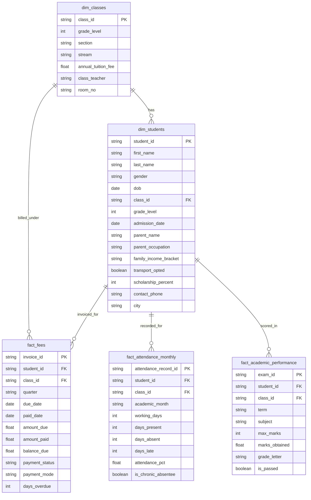

# EduManage Relational Data Dictionary & Schema Design

## 🏛️ Architecture: Star Schema Design
The data model follows a Kimball dimensional model (Star Schema) optimized for Power BI and analytical SQL reporting.

---

## 📋 Table Specifications

### 1. `dim_classes` (Dimension)
- **Grain**: 1 row per physical classroom/section.
- **Total Records**: 34 classes (Grade 1 to 12).
| Column Name | Data Type | Constraint | Description |
|---|---|---|---|
| `class_id` | TEXT | PRIMARY KEY | Unique Class identifier (e.g. `CLS-10A`, `CLS-12B`). |
| `grade_level` | INTEGER | NOT NULL | Grade numeric level (1 to 12). |
| `section` | TEXT | NOT NULL | Section name ('A', 'B', 'C'). |
| `stream` | TEXT | NOT NULL | Academic track: 'General', 'Science', 'Commerce'. |
| `annual_tuition_fee` | REAL | NOT NULL | Base annual tuition fee in INR (₹48k to ₹92k). |
| `class_teacher` | TEXT | NOT NULL | Full name of assigned faculty member. |
| `room_no` | TEXT | NULL | Assigned physical room number. |

### 2. `dim_students` (Dimension)
- **Grain**: 1 row per enrolled student.
- **Total Records**: 1,183 students.
| Column Name | Data Type | Constraint | Description |
|---|---|---|---|
| `student_id` | TEXT | PRIMARY KEY | Unique Student identifier (e.g. `STU-1001`). |
| `first_name` | TEXT | NOT NULL | Student first name. |
| `last_name` | TEXT | NOT NULL | Student surname. |
| `gender` | TEXT | NOT NULL | Gender ('Male', 'Female'). |
| `dob` | DATE | NOT NULL | Date of birth. |
| `class_id` | TEXT | FOREIGN KEY | References `dim_classes(class_id)`. |
| `grade_level` | INTEGER | NOT NULL | Current grade (1–12). |
| `admission_date` | DATE | NOT NULL | Date of admission. |
| `parent_name` | TEXT | NOT NULL | Guardian / Parent full name. |
| `parent_occupation` | TEXT | NOT NULL | Parent occupation category. |
| `family_income_bracket` | TEXT | NOT NULL | Income bracket ('< ₹3L', '₹3L - ₹6L', '₹6L - ₹12L', '₹12L - ₹25L', '> ₹25L'). |
| `transport_opted` | BOOLEAN | NOT NULL | Whether student uses school bus facility. |
| `scholarship_percent` | INTEGER | NOT NULL | Fee discount percentage (0%, 10%, 25%, 50%, 100%). |
| `contact_phone` | TEXT | NULL | Registered emergency phone contact. |
| `city` | TEXT | NOT NULL | Base city (`Delhi NCR`). |

### 3. `fact_fees` (Fact)
- **Grain**: 1 row per quarterly fee billing invoice per student.
- **Total Records**: 4,732 invoices (4 quarters per student).
| Column Name | Data Type | Constraint | Description |
|---|---|---|---|
| `invoice_id` | TEXT | PRIMARY KEY | Unique invoice ID (e.g. `INV-50001`). |
| `student_id` | TEXT | FOREIGN KEY | References `dim_students(student_id)`. |
| `class_id` | TEXT | FOREIGN KEY | References `dim_classes(class_id)`. |
| `quarter` | TEXT | NOT NULL | Academic quarter (`Q1`, `Q2`, `Q3`, `Q4`). |
| `due_date` | DATE | NOT NULL | Payment deadline date. |
| `paid_date` | DATE | NULL | Date transaction was settled (NULL if defaulter). |
| `amount_due` | REAL | NOT NULL | Billed amount in INR (adjusted for scholarship & bus). |
| `amount_paid` | REAL | NOT NULL | Settled amount in INR. |
| `balance_due` | REAL | NOT NULL | Outstanding balance in INR (`amount_due - amount_paid`). |
| `payment_status` | TEXT | NOT NULL | 'Paid On-Time', 'Paid Late', 'Partially Paid', 'Overdue Defaulter'. |
| `payment_mode` | TEXT | NULL | 'UPI', 'NetBanking', 'CreditCard', 'Cheque', 'Cash'. |
| `days_overdue` | INTEGER | NOT NULL | Days past due date. |

### 4. `fact_attendance_monthly` (Fact)
- **Grain**: 1 row per student per academic working month.
- **Total Records**: 13,013 records (11 working months).
| Column Name | Data Type | Constraint | Description |
|---|---|---|---|
| `attendance_record_id` | TEXT | PRIMARY KEY | Unique monthly log identifier. |
| `student_id` | TEXT | FOREIGN KEY | References `dim_students(student_id)`. |
| `class_id` | TEXT | FOREIGN KEY | References `dim_classes(class_id)`. |
| `academic_month` | TEXT | NOT NULL | Month in `YYYY-MM` format. |
| `working_days` | INTEGER | NOT NULL | Total scheduled school days in month. |
| `days_present` | INTEGER | NOT NULL | Actual days student attended. |
| `days_absent` | INTEGER | NOT NULL | Days student was absent. |
| `days_late` | INTEGER | NOT NULL | Days marked tardy/late. |
| `attendance_pct` | REAL | NOT NULL | Attendance percentage `(days_present / working_days) * 100`. |
| `is_chronic_absentee` | BOOLEAN | NOT NULL | Flag if attendance is strictly below 75.0%. |

### 5. `fact_academic_performance` (Fact)
- **Grain**: 1 row per student per subject examination per term.
- **Total Records**: 10,766 exam grades.
| Column Name | Data Type | Constraint | Description |
|---|---|---|---|
| `exam_id` | TEXT | PRIMARY KEY | Unique exam score record identifier. |
| `student_id` | TEXT | FOREIGN KEY | References `dim_students(student_id)`. |
| `class_id` | TEXT | FOREIGN KEY | References `dim_classes(class_id)`. |
| `term` | TEXT | NOT NULL | 'Term 1 (Midterm)', 'Term 2 (Final)'. |
| `subject` | TEXT | NOT NULL | Course name (e.g. Mathematics, Science, English). |
| `max_marks` | INTEGER | NOT NULL | Benchmark denominator (100). |
| `marks_obtained` | REAL | NOT NULL | Score achieved (0 to 100). |
| `grade_letter` | TEXT | NOT NULL | Grade bucket ('A+', 'A', 'B', 'C', 'D', 'F (Fail)'). |
| `is_passed` | BOOLEAN | NOT NULL | True if marks >= 40.0. |
